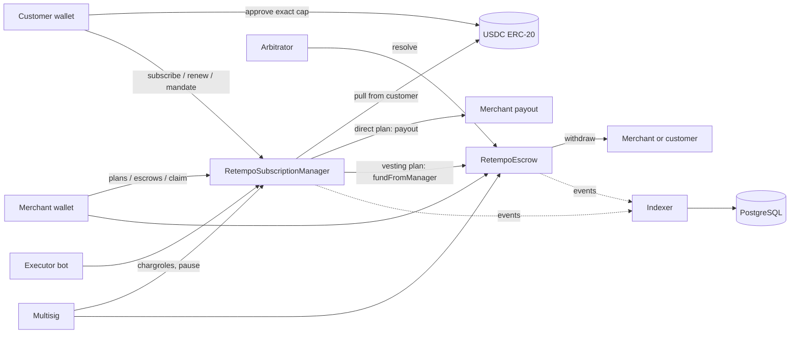

# RETEMPO Phase 3: Contract System Design (shared architecture)

> Historical imported design snapshot, not current authorization or verification evidence. Its phase numbering, "owner-approved" labels, installation/attestation claims and PostgreSQL assumptions must not be treated as decisions or actions approved in the current workspace. The active API is Workers/Hono + D1/Drizzle; the agreed target is Arc mainnet without a testnet deployment. Local tests remain mandatory and remote deployments/paid transactions require separate explicit approval. See `contracts/README.md`, `contracts/script/mainnet/README.md` and `docs/phase-3-evidence/` for current boundaries and evidence.

Sibling docs (specs for the code in `contracts/`): [`RetempoEscrow-design.md`](./RetempoEscrow-design.md), [`RetempoSubscriptionManager-design.md`](./RetempoSubscriptionManager-design.md), [`RETEMPO-backend-integration.md`](./RETEMPO-backend-integration.md). This file owns shared terminology, architecture, roles, security, testing and the final decisions.

## 1. Metadata

- Status: **Approved for implementation with the owner's adjustments (see section 17). Implemented in `contracts/`; not deployed; not independently audited.**
- Production target: Arc Mainnet (chain ID 5042). Development and tests: local only. Nothing is deployed or broadcast from Arc Studio.
- Language and toolchain: Solidity 0.8.28 (already pinned in `foundry.toml`), Foundry (forge 1.7.1 installed), OpenZeppelin Contracts 5.6.1 (pinned in `package.json`), forge-std 1.16.2.
- Review tracker (each box is checked only when that review closes):
  - [ ] Design review (owner sign-off on this doc)
  - [ ] Security review (independent audit, not started)
  - [ ] Ops review (multisig, key ceremony, monitoring)
  - [ ] Data review (database migration 0008 and indexer)
  - [ ] Compliance review (USDC blocklist and sanctions handling)

## 2. Action items (living)

- Open decisions D1 to D18 in section 17 need an answer or explicit acceptance of the recommendation.
- Phase 2 hardening items H1 to H4 in section 3 are scheduled before any indexer work.

## 3. Repository audit (Phase 1 and 2) and Arc verification

### 3.1 What exists

| Area | Finding |
| --- | --- |
| Web app | React/Vite app, wagmi + ConnectKit on **Arc Testnet** (`src/config.ts`). `src/services/blockchain` is hard-wired to `arcTestnet`; `submitPayment` throws `NotAvailableError`; escrow state reports `not_deployed`. |
| API | Bun API with PostgreSQL, 22 tables, 7 migrations, 99 passing tests. Escrow, payment and invoice-paid states are chain-controlled by DB triggers (`retempo_authoritative()`), reserved for a verified indexer. `runAuthoritative` in `backend/src/services/chainEvents.ts` is the unused Phase 3 seam. |
| Foundry | `foundry.toml`: solc 0.8.28, `evm_version = "cancun"`, no Arc RPC entries. `contracts/` holds only `Create2Factory.sol`, `DeployCreate2.s.sol` (generic scaffold scripts) and an empty `test/`. Remappings: forge-std and OZ from `node_modules`. |
| Tooling | Standard `forge` only. **Arc Foundry (`arc-forge`, `arc-anvil`) is not installed.** A release exists (v0.8.0-4) and GitHub is reachable from the sandbox. |

### 3.2 Network and token verification (what was and was not checked)

Checked against two sources: the repo's generated registry (`src/onchain-facts.ts`) and Arc's published documentation (`docs.arc.io`, `use-arc` guidance). Both agree:

| Item | Your spec | Registry | Arc docs |
| --- | --- | --- | --- |
| Chain ID | 5042 (0x13B2) | 5042 | 5042 |
| RPC | `https://rpc.mainnet.arc.io` | same | same |
| Explorer | `https://explorer.arc.io` | same | same |
| Native gas | USDC, 18 decimals | USDC, 18 | USDC, 18 |
| USDC ERC-20 | `0x3600000000000000000000000000000000000000`, 6 decimals | same | same |

**Not verified:** no query was made to Arc Mainnet (no RPC call, no `eth_chainId`, no `decimals()`, no code check at the USDC address). That keeps to your "no Mainnet operations" instruction. The external deployment script will perform these checks live at deploy time and abort on any mismatch. Offer: with your approval I can add a read-only check later.

Arc facts that shape the design (from `docs.arc.io/arc/references/evm-differences`):

- Arc targets the **Osaka** baseline. solc 0.8.28 with `cancun` is a safe subset (no new opcodes needed).
- USDC is the native balance. The ERC-20 view (6 decimals) and native view (18 decimals) are one pool. Our contracts use only the ERC-20 interface, never `msg.value`, never `selfdestruct`.
- **A blocklist is enforced at runtime.** Any USDC movement to or from a blocklisted address reverts. This drives the all-pull payout design (D3).
- Value transfers to `address(0)` revert. Contracts reject zero addresses explicitly.
- Standard `anvil` cannot reproduce Arc behavior. Faithful local tests need `arc-anvil --network arc` (D14).
- Finality is deterministic and instant (per Arc docs). Indexers still dedupe by `(chain_id, tx_hash, log_index)`.
- Two USDC event streams exist (system emitter at 18 decimals, ERC-20 at 6). Our indexer reads RETEMPO contract events only, so it never double-counts.

### 3.3 Compatibility issues (nothing breaks today; these must be fixed or decided)

| # | Issue | Impact | Resolution |
| --- | --- | --- | --- |
| C1 | `escrows` has no vesting or accounting columns (vest start/duration, claimed, awarded, refunded), and statuses lack a dispute-resolved split. | Cannot mirror contract state. | Additive migration 0008 (outline in the backend doc). |
| C2 | `mandates` has `max_amount_per_period` only; no cumulative cap, spent, next charge, on-chain key. | Cannot mirror mandate caps. | Additive columns in 0008. |
| C3 | `plans`/`subscriptions` have no on-chain keys; `transactions.kind` lacks subscription and mandate charges. | No correlation. | 0008 adds keys and kinds. |
| C4 | `SIWE_CHAIN_ID` defaults to 5042002 and `payments.chain_id` is taken from it; the web app's blockchain service is testnet-only. | Mixing SIWE chain and contract chain. | Separate `RETEMPO_CHAIN_ID` / contract-address config; keep SIWE as is. |
| C5 | wagmi config lists Arc Testnet and Ethereum mainnet only. | No Arc Mainnet wallet flow. | Add `arc` (5042) behind an env switch in the web phase; not in this phase. |
| C6 | Scaffold `Create2Factory`/`DeployCreate2` accept raw bytecode from env and validate nothing. | Unsafe for production. | Left untouched and **not used**. New scripts fail closed. |
| C7 | DB money is `BIGINT` (max 9.22e18 base units). | Contract amounts must fit. | Contract hard-caps any single amount at 1e15 base units (1 billion USDC). |

### 3.4 Security concerns in Phase 2 that matter before contracts go live

- **H1 (important).** `retempo_authoritative()` trusts a session setting any database session can set. The indexer must use a dedicated DB role, and the function should check that role. Without it, any code with DB write access can forge "funded" states.
- **H2.** Payout and customer wallet addresses are stored unverified. A typo in a plan payout address would route real USDC to the wrong place. Require a SIWE proof from the payout address before it can be registered on-chain.
- **H3.** The rate limiter is per process (fine for one instance only). Not contract-related, but the public launch needs a shared store.
- **H4.** API keys do not authenticate requests yet; webhooks do not exist. Neither is marked complete anywhere.

## 4. Goals and non-goals

Goals: non-upgradeable, auditable contracts for plan billing, customer-authorized capped recurring charges, and vesting escrow with refunds, disputes and arbitration, administered by a multisig that can never touch customer funds.

Non-goals: upgradeability, protocol fees, on-chain price oracles, gasless signed mandates (D8), multi-token support (USDC only), cross-chain, native `msg.value` payments, arbitrator fees, off-chain evidence storage, any fiat flow.

## 5. Requirements

Functional: F1 merchants create and manage plans. F2 customers subscribe and renew manually. F3 customers grant capped, expiring mandates that allow anyone to trigger due charges. F4 payments go directly to the merchant or into a vesting escrow per plan. F5 merchants claim vested funds. F6 refunds, disputes, arbitration, mutual settlement.

Security (each is a test): S1 no role can move escrowed USDC except through the accounting paths. S2 every USDC outflow is covered by recorded liabilities. S3 claims never exceed vested eligible balance. S4 claims + awards + refunds never exceed the deposit. S5 a revoked or expired mandate never charges. S6 mandate caps are never exceeded. S7 a period is never charged twice. S8 pausing never blocks claims, refunds, revocations, disputes or resolution. S9 role changes are two-step and delayed. S10 existing escrows and plans are unaffected by later config changes.

## 6. Terminology and actors

- **Base units**: USDC with 6 decimals (1 USDC = 1,000,000).
- **externalRef**: `bytes32` holding the Phase 2 UUID in its low 128 bits (`bytes32(uint256(uint128(uuid)))`), high bytes zero. Informational only.
- **Key**: deterministic `bytes32` id. Plan key = `keccak256(abi.encode(merchant, externalRef))`; subscription key = `keccak256(abi.encode(customer, externalRef))`; escrow key = `keccak256(abi.encode(merchant, invoiceRef))`. Keys cannot be squatted by another account, and the backend can compute them before sending a transaction.

| Actor | Where | Trust | Can do |
| --- | --- | --- | --- |
| Customer | wallet (EOA or smart wallet) | untrusted | subscribe, renew, grant/revoke mandate, cancel, fund, refund unvested (if allowed), dispute, settle |
| Merchant | wallet | untrusted | create plans, create escrows, claim vested, refund, respond, settle |
| Recurring executor | anyone (RETEMPO backend bot or third party) | untrusted | call `charge`; cannot choose amount, payee or timing |
| Arbitrator | allowlisted address | semi-trusted | resolve disputes on escrows that named it, within the disputed balance only |
| Admin (multisig) | multisig | trusted, constrained | grant/revoke roles, unpause |
| Config / Pauser / Arbitrator-manager | multisig or delegated accounts | trusted, constrained | bounded parameters for new items / pause only / allowlist only |
| Circle (USDC issuer) | external | trusted external dependency | can blocklist addresses or pause USDC; outside our control |
| Indexer | backend | trusted for bookkeeping only | read events, write DB; holds no keys |

## 7. Language and runtime

Solidity 0.8.28 (checked arithmetic; every `unchecked` block must be justified in review). EVM `cancun` (valid subset of Arc's Osaka). Contracts import OpenZeppelin: `AccessControlDefaultAdminRules`, `Pausable`, `ReentrancyGuard`, `SafeERC20`, `Math`. One immutable token: the Arc USDC address given at construction (and re-validated by the deploy script).

## 8. Architecture

Dependencies: USDC ERC-20 at the Arc address (6 decimals); no oracles; no other external contracts. `RetempoSubscriptionManager` holds `escrow` and `RetempoEscrow` holds `manager`, both immutable. Deployment predicts the manager address from the deployer nonce, so neither contract needs a setter.

### Flow of funds

| Step | Who moves what | Invariant |
| --- | --- | --- |
| Direct plan payment | customer to merchant payout, `transferFrom`, via the manager | manager balance unchanged (no USDC at rest) |
| Escrowed plan payment | customer to manager to escrow (pull with exact approval, balance-delta check) | escrow liabilities up by exactly the amount received |
| Standalone escrow funding | customer to escrow (pull) | same |
| Claim / refund / award | internal credit: escrow balance down, `withdrawable[account]` up | total liabilities unchanged |
| Withdraw | escrow to `to`, only from caller's `withdrawable` | liabilities down by exactly the amount sent |
| Resting state | escrow balance >= sum(escrow balances) + sum(withdrawable) | holds after every call (invariant I1) |

The manager must hold zero USDC at rest and zero allowance to the escrow after every call.

## 9. Roles (summary; full detail in the sibling docs)

| Role | Holder | Permissions | Why |
| --- | --- | --- | --- |
| `DEFAULT_ADMIN_ROLE` | multisig | grant/revoke roles; unpause. Two-step transfer with delay (`AccessControlDefaultAdminRules`) | governance |
| `CONFIG_ROLE` | multisig | set bounded parameters used only for **new** plans/escrows | tuning without touching live funds |
| `PAUSER_ROLE` | multisig or guardian | `pause()` only | fast stop |
| `ARBITRATOR_MANAGER_ROLE` | multisig | add/remove arbitrators on the allowlist | independence |
| Allowlisted arbitrator | external parties | resolve disputes on escrows that named them | dispute resolution |

There is **no** role that can transfer, sweep, rescue, confiscate or reassign escrowed USDC, and no `renounce` path to a dead admin (default-admin renounce is also delayed).

## 10. Security considerations

| Vulnerability | Applicable | Mitigation |
| --- | --- | --- |
| Reentrancy | Yes (USDC calls) | CEI ordering plus `nonReentrant` on every function with an external call |
| Access control | Yes | Role matrix above; every privileged function enumerated in sibling docs |
| Overflow/underflow | Checked math | `Math.mulDiv` for vesting; amounts bounded by 1e15 |
| Unchecked call / return | Yes | `SafeERC20`; balance-delta check on escrow deposits |
| Fee-on-transfer / rebasing | Token fixed to USDC | delta check anyway |
| Signature replay | No signatures in v1 | EIP-712/1271 deferred (D8) |
| Front-running / MEV | Low | mandate/creation terms are committed on-chain before funding; `fund` and `acceptSettlement` take the expected terms as parameters |
| Oracle / flash loan | None used | n/a |
| Denial of service | Yes | pull payouts (blocklisted or reverting recipient cannot block others); no unbounded loops |
| Delegatecall / proxy | None | non-upgradeable, no delegatecall |
| Timestamp dependence | Yes | only coarse windows (hours to days); Arc timestamps are non-decreasing, not strictly increasing, so no logic needs strict increase |
| Approval persistence | Yes | mandates require finite caps; docs tell customers to approve the cap, not max; manager-to-escrow allowance forced to zero after use |
| Centralization | Yes | multisig + delays; admin cannot reach customer funds (section 11) |
| USDC blocklist/pause by issuer | Yes (external) | all-pull ledger; merchant and customer may withdraw to a different address; document residual risk |
| Forced funds (donation) | Yes | accounting uses internal totals, never `balanceOf` as truth; surplus is simply unclaimable; no sweep function |
| Dispute griefing | Yes | freeze limited to one escrow; bounded timeout; deterministic fallback |
| Arbitrator corruption | Yes | allowlist, party-conflict check, funds only to the two parties, timeout fallback, merchant picks and customer sees terms before funding |
| Dust / rounding | Yes | floor-based vesting; exact full vest at end; minimum deposit |
| Griefing by charge caller | Yes | caller cannot influence amount, payee or timing |

## 11. Trust model and threat analysis

| Key | Max damage if compromised | Mitigation | Detection |
| --- | --- | --- | --- |
| Multisig admin | grant itself other roles, unpause, change bounded parameters for future items, add arbitrators. **Cannot** move or freeze existing funds. | multisig threshold, admin delay, parameters not retroactive | role events, `DefaultAdminTransferScheduled`, `ParametersUpdated` alerts |
| Pauser | stop new plans, subscriptions, charges, escrows (self-limited: claims, refunds, revocations, disputes still work) | pause-only, unpause by admin | `Paused` event alert |
| Config | change future params within hard-coded bounds | bounds in code, not retroactive | `ParametersUpdated` |
| Arbitrator-manager | add a hostile arbitrator that merchants could then select; customers see arbitrator before funding | customer-side check in UI; per-escrow naming | `ArbitratorAdded` alert |
| Arbitrator | award a disputed balance entirely to either party on escrows that named it | only disputed balance, only between the two parties, conflict check, timeout | `DisputeResolved` review |
| Merchant key | redirect own payouts, refund, claim own vested funds, cancel | limited to own plans/escrows | merchant-side alerts |
| Customer key | lose that customer's own funds only | caps, revocation | n/a |
| Deployer key | none after deployment if admin is the multisig at construction (D2) | script checks | deploy checklist |

## 12. Emergency response

`pause()` (Pauser) blocks: plan creation/reactivation, subscribe, renew, charge, mandate creation, escrow creation and funding. It never blocks: mandate revocation, cancellation, claim, merchant refund, customer unvested refund, dispute open/respond/resolve/expire, settlement, `withdraw`. `unpause()` needs the admin. Contracts are **deployed paused** (D13); the multisig unpauses only after audit sign-off. Playbook and alerts are in the backend doc.

## 13. Failure scenarios

- USDC blocklists a merchant: charges to that payout revert, customers keep funds; escrow claims credit the ledger and only `withdraw` to a blocked address fails, so the merchant withdraws to another address.
- USDC blocklists a customer: refunds credit their ledger and wait; others are unaffected.
- Arbitrator vanishes or is removed: after `resolutionTimeout` anyone calls `expireDispute`; split is deterministic (vested at dispute time to the merchant, rest to the customer).
- Executor offline: nothing is lost; the next charge may be a lapse re-base (D10), so customers are not billed for missed time.
- Allowance too low or balance short: `charge` reverts with a typed error; no state changes.
- Manager-to-escrow deposit with unexpected balance delta: whole payment reverts.
- Index lag or duplicate events: handled by idempotent indexer (backend doc).

## 14. Priorities and tradeoffs

| Decision | Chosen | Rejected | Reason |
| --- | --- | --- | --- |
| Upgradeability | none | UUPS proxy | smaller audit surface; migrate by new deployment |
| Payouts | pull ledger | push | blocklist makes push unsafe (DoS) |
| Ids | deterministic keys + externalRef | counters | unsquattable, backend-precomputable |
| Mandates | on-chain tx | EIP-712 signatures | no replay surface, works for smart wallets |
| Admin | multisig + two-step delay | single owner | blast radius |
| Escrow governance | terms frozen per escrow | live-global params | admin cannot change live outcomes |
| Dispute | freeze only the disputed amount (D4) | freeze all | undisputed vested funds stay claimable; ruling capped at the disputed amount |
| Intervals | fixed seconds | calendar months | determinism |
| Executor | permissionless | allowlist/keeper fee | no trust, no economics yet |

## 15. Testing strategy

Tooling: `forge test` (standard Foundry) with a 6-decimal mock USDC that includes a configurable blocklist. Fuzz and invariant suites with handler contracts and ghost variables. Optional Arc-faithful runs through `arc-forge`/`arc-anvil` (D14). Mainnet-fork tests are **prepared as a documented, opt-in script** that needs an explicit RPC variable and is not run in Arc Studio.

Invariants (each has a handler-driven test):

| # | Invariant | Contract |
| --- | --- | --- |
| I1 | USDC balance >= sum(escrow balances) + sum(withdrawable) | Escrow |
| I2 | per escrow: claimed <= min(vested - carvedVested, deposit - refunded - awarded - frozen) | Escrow |
| I3 | per escrow: refunded <= deposit - claimed - awarded; credits to customer never exceed refundable balance | Escrow |
| I4 | per escrow: claimed + awarded + refunded <= deposit, and equal when Closed | Escrow |
| I5 | a charge never succeeds on a revoked or expired mandate | Manager |
| I6 | mandate `spent` <= `totalCap`, each charge <= `perChargeCap` | Manager |
| I7 | charge count per subscription <= 1 + floor(elapsed / interval); two charges never share a period | Manager |
| I8 | no admin-role call sequence reduces any account's withdrawable or any escrow balance | both |
| I9 | manager holds zero USDC and zero allowance at rest | Manager |

Plus unit tests for every function and revert, integration tests across both contracts, fuzzing of vesting math and rounding, reentrancy attempts with a malicious token mock, pause matrix, role-transfer flow, and gas report. Static analysis: Slither. Coverage target: 100% of statements, branch coverage reported honestly.

Commands (to be run and reported verbatim after approval): `forge build`, `forge test -vv`, `forge test --match-path 'test/invariant/*' --fuzz-runs 1000`, `forge coverage`, `slither .`.

## 16. Deployment and initialization (preparation only)

1. Scripts live in `contracts/script/mainnet/`. They are written for an **external** machine and never run in Arc Studio.
2. Fail-closed checks before any broadcast: `block.chainid == 5042`; RPC URL equals the configured Arc Mainnet URL and none is defaulted; `USDC` equals `0x3600...0000` and `decimals() == 6`; multisig is a nonzero contract address from env, not equal to the deployer, with code; constructor arguments match a checked manifest; predicted manager address equals the actual one; roles end up on the multisig; contracts start paused.
3. Constructor parameters: Escrow(usdc, manager, admin, adminDelay, pauser, configManager, arbitratorManager, maxAggregateExposure), Manager(usdc, escrow, admin, adminDelay, pauser, configManager). Both start paused. Initial limits: 10,000 USDC per payment and escrow, 0.01 USDC minimum.
4. Post-deploy verification and checklists are generated with the scripts (phase 5 of the plan).

## 17. Final decisions (owner-approved; adjustments marked)

| ID | Final decision |
| --- | --- |
| D1 (adjusted) | Multisig architecture kept with **placeholders only**. No Safe address is invented or hardcoded. The multisig address, threshold and authorized signers are **deployment blockers** until independently verified; the external script refuses to run without them. The emergency pauser is a **separate** account that may only `pause()` and must differ from the admin (enforced in the constructors). Admin delay is configurable (recommended 3 days). |
| D2 | Admin is the multisig at construction; the deployer holds no role. (The two-step delayed transfer from `AccessControlDefaultAdminRules` still exists for future rotation.) |
| D3 (adjusted) | All-pull ledger. A failing or blocklisted recipient affects only its own `withdraw`. Beneficiaries can set a payout address by direct call or by their own EIP-712 signature (EOA or EIP-1271). No admin path exists. |
| D4 (adjusted) | **Partial freeze**: only the disputed amount is frozen; undisputed vested funds stay claimable; arbitrator rulings are capped at the disputed amount. One dispute per escrow. |
| D5 (adjusted) | Merchant proposes an allowlisted arbitrator; the customer must explicitly accept it before funding (`fund` takes the arbitrator and a terms hash; `subscribe` takes `acceptedArbitrator`). Replacement only by mutual consent. Conflict rules are enforced on-chain (section 6 of the escrow doc). |
| D6 | Response window 7 days (1 to 30); resolution timeout 30 days (7 to 90). |
| D7 | Customer unvested refund only when the merchant sets the per-escrow flag. |
| D8 | Mandates by explicit on-chain customer transaction. Per-charge cap, cumulative cap, interval, expiry, revocation, allowance, balance and duplicate-period protection all enforced on-chain. |
| D9 | Fixed-second intervals (month 30 days, year 365 days). |
| D10 | Lapse re-base after grace. |
| D11 | Permissionless executor, no reward. |
| D12 | No fees in v1. |
| D13 (adjusted) | Deployed **paused**. Max **10,000 USDC per payment/escrow** at launch. A configurable **aggregate escrow exposure limit** (`totalLocked + totalWithdrawable`) is enforced when funding. All limits change only through `CONFIG_ROLE` (multisig), within hard bounds, and emit `ParameterUpdated`. |
| D14 (adjusted) | Arc Foundry v0.8.0-4 installed locally from the official release for local testing only. SHA-256 matched the published checksum and the Sigstore bundle verified (see the report). No Mainnet wallets, keys or funds. |
| D15 | solc 0.8.28 / cancun. |
| D16 | Phase 2 hardening H1 and H2 remain open and are listed as unresolved security issues. |
| D17 | Trials included. |
| D18 | Minimum 0.01 USDC. |

## 18. Third-party libraries

| Library | Version | Already a dependency | Why | Security-reviewed |
| --- | --- | --- | --- | --- |
| OpenZeppelin Contracts | 5.6.1 | yes | access control, pause, SafeERC20, reentrancy guard, math | widely audited; we audit our usage |
| forge-std | 1.16.2 | yes | tests and scripts | test-only |

No other dependencies.

## 19. Stakeholders

Owner (design sign-off and D1 to D18), security auditor (independent, to be engaged by you), multisig signers (deployment and roles), backend (migration 0008, indexer), compliance (blocklist handling).
